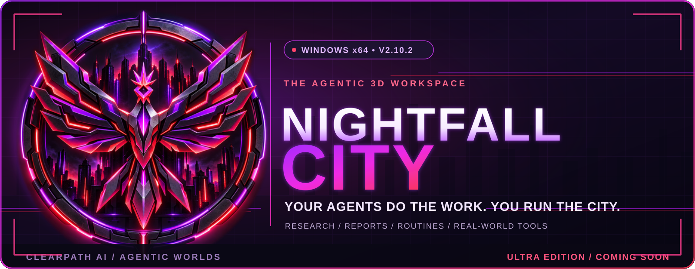
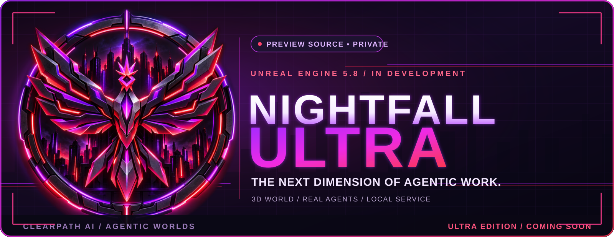

### Your agents do the work. **You run the city.**

**An immersive 3D agentic workspace where AI agents perform real tasks and the city becomes your command center.**

**[Download for Windows](https://github.com/taevinbellamy88/nightfall-city-releases/releases/latest)** · **[Official Website](https://nightfallcity.cpengine.store)** · **[Get Access](https://nightfallcity.cpengine.store/#offers)** · **[v2.10.2 Release](https://github.com/taevinbellamy88/nightfall-city-releases/releases/tag/v2.10.2)**

---

## Welcome to Nightfall City

**Not another chatbot. Not just another dashboard.** Nightfall City visualizes an agent-driven workspace as an explorable, customizable 3D city. Instead of burying every task in chat tabs, you can work with agents through a living world.

**Research. Reports. Routines.** Direct agents, inspect their work and bring your own compatible connections. The city is the interface; external actions depend on the actual configured models, tools, permissions and services.

| | What it means |
| :--- | :--- |
| **An explorable 3D city** | Navigate and customize the environment that represents your working world. |
| **AI agents with real tasks** | Research, reporting, routines and tool-connected workflows rather than a static animation. |
| **Connect your own intelligence** | Configure optional providers and local models, including Ollama, from the application. |
| **Your work, visible** | Use the application's work and agent surfaces to see activity and take action. |
| **Paper-trading integrations** | Experiment with supported paper accounts. **Paper trading only**; no promise of live execution or financial returns. |
| **Ultra on the horizon** | A separate Unreal Engine 5.8 edition is being developed. **Ultra is not included in this download.** |

## Download Nightfall City

The current published desktop release is **[v2.10.2](https://github.com/taevinbellamy88/nightfall-city-releases/releases/tag/v2.10.2)** for **Windows x64**.

1. **Download** [`NightfallCity-Setup-2.10.2-x64.exe`](https://github.com/taevinbellamy88/nightfall-city-releases/releases/download/v2.10.2/NightfallCity-Setup-2.10.2-x64.exe), or use [Latest Releases](https://github.com/taevinbellamy88/nightfall-city-releases/releases/latest) for a newer build.
2. **Verify your download.** The release includes a [SHA-256 checksum file](https://github.com/taevinbellamy88/nightfall-city-releases/releases/download/v2.10.2/NightfallCity-Setup-2.10.2-x64.exe.sha256) and updater-related signature files. Check the checksum against the installer. The product website currently notes that the installer is not yet code-signed, so Windows SmartScreen may display a warning.
3. **Install and activate.** Nightfall City requires a valid activation key. Access options are available at the [official website](https://nightfallcity.cpengine.store/#offers).
4. **Configure optional models and connections** inside the application, as needed for the tasks you want your agents to perform.

> **Windows desktop release only.** There is no official macOS or Linux installer listed for v2.10.2. Downloading the application and purchasing an activation key are separate steps.

### Release files

| File | Purpose |
| :--- | :--- |
| [Windows installer `2.10.2-x64.exe`](https://github.com/taevinbellamy88/nightfall-city-releases/releases/download/v2.10.2/NightfallCity-Setup-2.10.2-x64.exe) | Desktop application |
| [`.sha256` checksum](https://github.com/taevinbellamy88/nightfall-city-releases/releases/download/v2.10.2/NightfallCity-Setup-2.10.2-x64.exe.sha256) | Integrity verification |
| [`latest.json`](https://github.com/taevinbellamy88/nightfall-city-releases/releases/download/v2.10.2/latest.json) | Release/update metadata |
| [All releases](https://github.com/taevinbellamy88/nightfall-city-releases/releases) | Version history and future downloads |

## Nightfall City Ultra — coming soon

The **Ultra** edition is an Unreal Engine 5.8 client being developed as a visually richer, first-person counterpart to Nightfall City. Its planned architecture integrates with the local agent service while maintaining a separate product, activation and data environment.

**Status:** development / private source. No public Ultra installer is provided by this releases repository. Planned visual upgrades, asset packs and the commercial rollout should not be treated as shipped capabilities.

## Important distinctions

- **This public repository distributes installers and update artifacts**, not the game's private source code.
- **The website** at [nightfallcity.cpengine.store](https://nightfallcity.cpengine.store) handles product information and access.
- **AI actions are real only when the required provider, tool and permission are configured.** Not every depicted or planned capability is available without setup.
- **Trading references are educational and paper-only.** This project is not financial advice; no earnings or investment returns are guaranteed.

## Questions & support

For purchase questions, activation assistance, download problems or product updates, visit the [official Nightfall City website](https://nightfallcity.cpengine.store) or use its [contact page](https://nightfallcity.cpengine.store/contact).

---

  

  **NIGHTFALL CITY** · Powered by **ClearPath AI**

  *Build your world. Command your agents. Make real work visible.*

